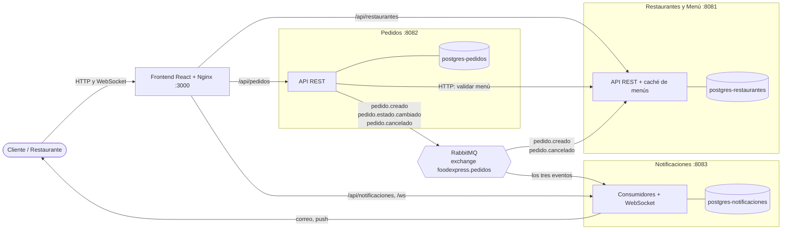
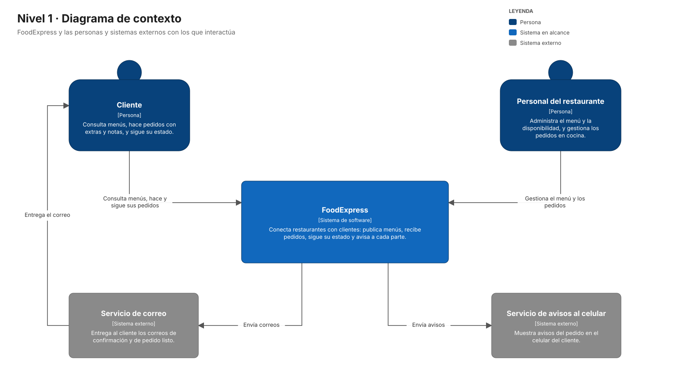
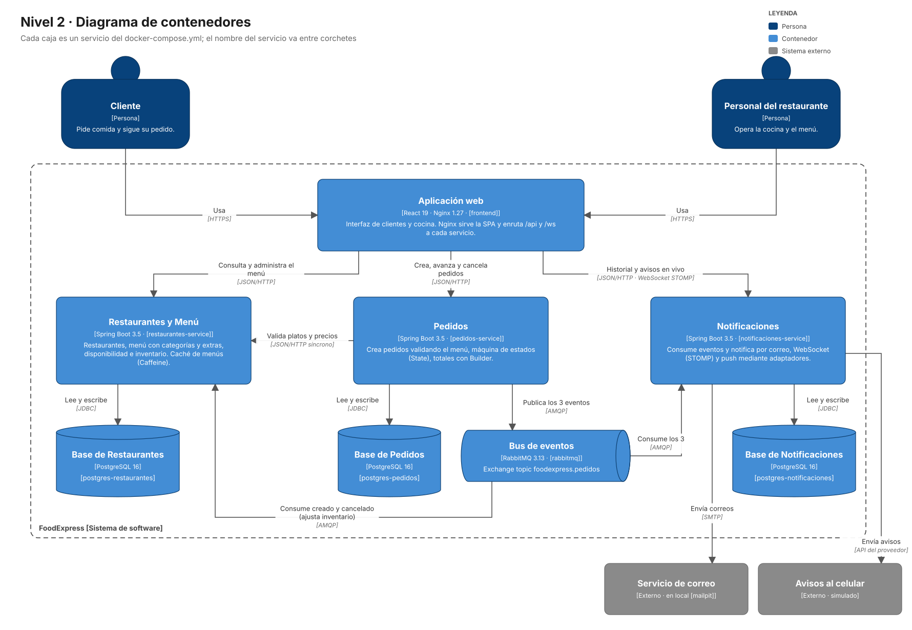
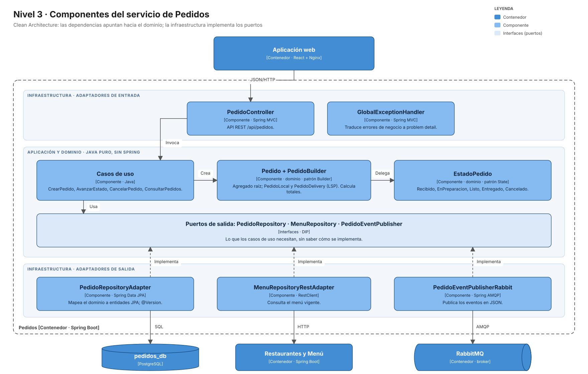

# FoodExpress

Sistema de pedidos de comida que conecta restaurantes con clientes. Proyecto de semestre de **Diseño y Arquitectura de Software** (proyecto 7 del catálogo).

Los restaurantes publican su menú, los clientes hacen pedidos con extras y notas, y cada pedido avanza por un flujo de estados (recibido, en preparación, listo, entregado o cancelado) mientras el cliente y el restaurante reciben notificaciones.

- [Arquitectura](#arquitectura)
- [Diagramas C4](#diagramas-c4)
- [Cómo ejecutarlo](#cómo-ejecutarlo)
- [Frontend](#frontend)
- [Recorrido de demostración](#recorrido-de-demostración)
- [API](#api)
- [Flujos asíncronos con RabbitMQ](#flujos-asíncronos-con-rabbitmq)
- [Clean Architecture](#clean-architecture)
- [Patrones de diseño](#patrones-de-diseño)
- [Principios SOLID](#principios-solid)
- [Atributos de calidad](#atributos-de-calidad)
- [Pruebas](#pruebas)
- [Decisiones y limitaciones](#decisiones-y-limitaciones)
- [Documentación del proyecto](#documentación-del-proyecto)

## Arquitectura

**Estilo arquitectónico:** microservicios con comunicación dirigida por eventos, y Clean Architecture (puertos y adaptadores) dentro de cada servicio.

Tres microservicios independientes, cada uno con su propia base de datos, y un frontend React servido por Nginx. La única llamada síncrona entre servicios es la consulta del menú al crear un pedido; todo lo demás viaja como eventos por RabbitMQ.

Requisitos funcionales, reglas de negocio y atributos de calidad: [`docs/REQUISITOS.md`](docs/REQUISITOS.md). Decisiones de arquitectura: [`docs/adr/`](docs/adr/).



| Servicio | Puerto | Responsabilidad |
|---|---|---|
| `restaurantes-service` | 8081 | Registro de restaurantes, menú con categorías y extras, disponibilidad de platos |
| `pedidos-service` | 8082 | Creación de pedidos, máquina de estados, cálculo de totales |
| `notificaciones-service` | 8083 | Consume los eventos y notifica por correo, WebSocket y push |
| `frontend` | 3000 | Interfaz de clientes y cocina; Nginx enruta `/api` y `/ws` a cada servicio |

**Tecnologías:** Java 17 (ejecución en Java 21), Spring Boot 3.5.6, Spring Data JPA, PostgreSQL 16.6, RabbitMQ 3.13, Caffeine, WebSocket/STOMP, React 19, Vite 8, TypeScript 5.9, Nginx 1.27, Docker Compose v2.

## Diagramas C4

Los tres primeros niveles del modelo C4 están en [`docs/c4/`](docs/c4/), como imágenes y como código ([`workspace.dsl`](docs/c4/workspace.dsl), Structurizr). Las imágenes se regeneran con `python3 docs/c4/generar_c4.py`.

| Nivel | Diagrama |
|---|---|
| 1 · Contexto |  |
| 2 · Contenedores |  |
| 3 · Componentes de Pedidos |  |

## Cómo ejecutarlo

### Opción 1: todo con Docker (recomendada)

Requiere Docker Desktop (o Docker Engine con Compose v2).

```bash
cp .env.example .env          # y cambie las claves
docker compose up --build
```

Las credenciales no están en el `docker-compose.yml`: se leen de `.env`, que no se sube al repositorio. Si falta una variable obligatoria, Compose se detiene antes de arrancar y dice cuál.

La primera vez tarda varios minutos porque descarga las dependencias de Maven y npm. Se levantan 9 contenedores: tres PostgreSQL (uno por servicio), RabbitMQ, Mailpit, los 3 microservicios y el frontend. Los servicios arrancan en orden: cada uno espera a que sus dependencias estén sanas (`depends_on` con `condition: service_healthy`). Para ver el estado:

```bash
docker compose ps             # la columna STATUS debe decir (healthy) en los 9
```

Para empezar desde cero, borrando los datos: `docker compose down -v`.

#### Puertos publicados

| Puerto | Servicio | Por qué se publica |
|---|---|---|
| **3000** | `frontend` | **La aplicación**: http://localhost:3000. Es el único que necesita un usuario final |
| 8081 | `restaurantes-service` | Probar la API directamente con `peticiones.http` o Postman |
| 8082 | `pedidos-service` | Probar la API directamente |
| 8083 | `notificaciones-service` | Probar la API y el WebSocket sin pasar por el frontend |
| 8025 | `mailpit` | Ver en una bandeja web los correos que se enviaron a los clientes |
| 15672 | `rabbitmq` | Consola de RabbitMQ: colas, mensajes y colas de mensajes muertos (usuario y clave de `.env`) |

Las bases de datos, el puerto AMQP de RabbitMQ y el SMTP de Mailpit **no** se publican: solo los alcanzan los servicios, por redes internas.

#### Health checks y redes

| Servicio | Health check |
|---|---|
| `postgres-*` | `pg_isready` |
| `rabbitmq` | `rabbitmq-diagnostics ping` |
| `mailpit` | `mailpit readyz` |
| `*-service` | `curl /actuator/health` (Spring Boot Actuator): sano solo si su base de datos y RabbitMQ responden |
| `frontend` | `wget` a la página de inicio de Nginx |

| Red | Conecta |
|---|---|
| `red-datos-restaurantes`, `red-datos-pedidos`, `red-datos-notificaciones` | Cada servicio con **su** base de datos; ninguno alcanza la base de otro |
| `red-mensajeria` | RabbitMQ y los tres servicios |
| `red-correo` | Notificaciones y Mailpit |
| `red-servicios` | Pedidos y Restaurantes (validación síncrona del menú) |
| `red-web` | El frontend (Nginx) y los tres servicios |

Detalle de las decisiones en [ADR-018](docs/adr/ADR-018-docker-compose.md).

### Opción 2: servicios desde el IDE o con Maven

Requiere JDK 17 o superior y Maven 3.9.

```bash
# 1. Solo la infraestructura, con sus puertos publicados en el equipo
docker compose -f docker-compose.yml -f docker-compose.dev.yml up \
    postgres-restaurantes postgres-pedidos postgres-notificaciones rabbitmq mailpit

# 2. Las mismas credenciales de .env como variables de entorno, y cada servicio en su terminal
#    (DB_USER/DB_PASSWORD con los valores del servicio que arranca; RABBITMQ_USER/RABBITMQ_PASSWORD)
cd restaurantes-service   && DB_USER=... DB_PASSWORD=... RABBITMQ_USER=... RABBITMQ_PASSWORD=... mvn spring-boot:run
cd notificaciones-service && DB_USER=... DB_PASSWORD=... RABBITMQ_USER=... RABBITMQ_PASSWORD=... mvn spring-boot:run
cd pedidos-service        && DB_USER=... DB_PASSWORD=... RABBITMQ_USER=... RABBITMQ_PASSWORD=... mvn spring-boot:run
```

Arranque Restaurantes y Notificaciones antes que Pedidos, para que sus colas ya existan cuando se publique el primer evento.

Para que Notificaciones envíe los correos a Mailpit, defina `SPRING_MAIL_HOST=localhost` y `SPRING_MAIL_PORT=1025` antes de arrancarlo. Sin esas variables el correo se simula y aparece en el log como `[EMAIL simulado]`.

Y el frontend en modo desarrollo (requiere Node 20 o superior):

```bash
cd frontend
npm install
npm run dev        # http://localhost:5173, con recarga al guardar
```

## Frontend

Aplicación de una sola página hecha con **React 19, Vite y TypeScript**, con React Router para la navegación y `@stomp/stompjs` para las notificaciones en tiempo real. No usa librerías de componentes: los estilos son CSS propio.

| Pantalla | Ruta | Qué hace |
|---|---|---|
| Restaurantes | `/` | Lista los restaurantes y si están abiertos |
| Menú y carrito | `/restaurantes/:id` | Menú por categorías; elegir extras, cantidad y notas; recoger o domicilio; total estimado |
| Seguimiento | `/pedidos/:id` | Línea de tiempo del estado, detalle y totales confirmados, notificaciones en vivo; cancelar si el estado lo permite |
| Mis pedidos | `/mis-pedidos` | Pedidos del cliente por correo |
| Cocina | `/cocina/:id` | Tablero Recibido / En preparación / Listo con avisos en vivo; abrir o cerrar; disponibilidad y unidades de cada plato |

Decisiones:

- **Un solo origen.** El navegador solo habla con el puerto 3000; Nginx (en Docker) o Vite (en desarrollo) reenvían cada ruta al servicio que corresponde, así no hace falta configurar CORS en los microservicios.
- **El backend manda.** El carrito muestra un total estimado con la misma regla del dominio, pero no envía precios: el total definitivo lo calcula Pedidos con el menú vigente.
- **Reglas visibles.** Los botones de cancelar solo aparecen cuando el patrón State lo permite (cliente en Recibido; restaurante en Recibido o En preparación).
- **Sin inicio de sesión.** El cliente se identifica con su correo, que se recuerda en el navegador.

Pruebas del carrito: `cd frontend && npm test`.

## Recorrido de demostración

El archivo [`peticiones.http`](peticiones.http) tiene el recorrido completo, listo para ejecutar desde IntelliJ IDEA o desde VS Code con la extensión REST Client. El servicio de Restaurantes carga dos restaurantes de ejemplo al arrancar.

Versión corta con `curl`:

```bash
# 1. Ver el menú del restaurante 1
curl http://localhost:8081/api/restaurantes/1/menu

# 2. Abrir http://localhost:3000/cocina/1 para ver llegar el pedido en vivo

# 3. Crear un pedido: 2 hamburguesas con queso y tocineta, y 1 limonada
curl -X POST http://localhost:8082/api/pedidos \
  -H "Content-Type: application/json" \
  -d '{
        "restauranteId": 1,
        "cliente": { "nombre": "Ana Gómez", "email": "ana@correo.com" },
        "tipo": "LOCAL",
        "items": [
          { "platoId": 2, "cantidad": 2, "extraIds": [1, 2], "notasEspeciales": "Sin cebolla" },
          { "platoId": 4, "cantidad": 1 }
        ]
      }'

# 4. Avanzar el pedido: en preparación, listo, entregado (una llamada por paso)
curl -X PATCH http://localhost:8082/api/pedidos/1/avanzar

# 5. Ver qué se notificó
curl "http://localhost:8083/api/notificaciones?pedidoId=1"
```

Lo mismo se puede hacer desde la interfaz en http://localhost:3000. En el paso 3 la cocina recibe el pedido nuevo sin recargar, y en Mailpit aparece el correo. En cada avance del paso 4 llega una actualización en tiempo real.

Otros escenarios que vale la pena mostrar (están en `peticiones.http`):

- **Inventario por eventos:** pedir las 5 unidades de Costillas BBQ deja el plato agotado; un segundo pedido se rechaza con 422. Al cancelar el primero, las unidades vuelven.
- **Reglas por estado:** un pedido en preparación no lo puede cancelar el cliente (409), pero sí el restaurante.
- **Disponibilidad:** detener `notificaciones-service`, crear pedidos (siguen funcionando) y volver a arrancarlo: procesa todo lo pendiente.

## API

### Restaurantes y Menú (8081)

| Método | Ruta | Descripción |
|---|---|---|
| POST | `/api/restaurantes` | Registrar restaurante (queda cerrado) |
| GET | `/api/restaurantes` | Listar restaurantes |
| GET | `/api/restaurantes/{id}` | Consultar restaurante |
| PUT | `/api/restaurantes/{id}` | Actualizar datos |
| PATCH | `/api/restaurantes/{id}/estado` | Abrir o cerrar |
| GET | `/api/restaurantes/{id}/menu` | Menú (filtros `categoria`, `soloDisponibles`); con caché |
| GET | `/api/restaurantes/{id}/platos?ids=1,2` | Platos puntuales sin caché; lo usa Pedidos |
| GET | `/api/platos/{id}` | Consultar plato |
| POST | `/api/restaurantes/{id}/platos` | Agregar plato |
| PUT | `/api/platos/{id}` | Actualizar plato |
| PATCH | `/api/platos/{id}/disponibilidad` | Habilitar o retirar; fijar unidades |
| DELETE | `/api/platos/{id}` | Eliminar plato |
| POST | `/api/platos/{id}/extras` | Agregar extra |
| DELETE | `/api/platos/{id}/extras/{extraId}` | Quitar extra |

### Pedidos (8082)

| Método | Ruta | Descripción |
|---|---|---|
| POST | `/api/pedidos` | Crear pedido |
| GET | `/api/pedidos/{id}` | Consultar pedido |
| GET | `/api/pedidos?restauranteId=` o `?clienteEmail=` | Listar pedidos |
| PATCH | `/api/pedidos/{id}/avanzar` | Pasar al siguiente estado |
| POST | `/api/pedidos/{id}/cancelar` | Cancelar (`canceladoPor`: `CLIENTE` o `RESTAURANTE`) |

### Notificaciones (8083)

| Tipo | Ruta | Descripción |
|---|---|---|
| GET | `/api/notificaciones?pedidoId=` | Historial de notificaciones de un pedido |
| WebSocket | `ws://localhost:8083/ws` | Conexión STOMP |
| Tema | `/topic/pedidos/{pedidoId}` | Seguimiento del pedido (cliente) |
| Tema | `/topic/restaurantes/{restauranteId}` | Pedidos nuevos y cancelaciones (restaurante) |

Los errores se devuelven en formato *problem detail* (`application/problem+json`): 400 datos inválidos, 404 no existe, 409 transición no permitida o conflicto de concurrencia, 422 plato o restaurante no disponible, 503 no se pudo consultar el menú.

## Flujos asíncronos con RabbitMQ

Pedidos publica en el exchange `foodexpress.pedidos` (tipo *topic*). Cada consumidor declara sus propias colas durables.

| Evento | Cuándo se publica | Quién lo consume y qué hace |
|---|---|---|
| `pedido.creado` | Al guardarse un pedido nuevo | **Notificaciones:** alerta al restaurante (WebSocket) y confirma al cliente (correo y WebSocket). **Restaurantes:** descuenta unidades de los platos con inventario |
| `pedido.estado.cambiado` | En cada avance de estado | **Notificaciones:** informa al cliente en tiempo real (WebSocket y push); si quedó listo, también por correo |
| `pedido.cancelado` | Al cancelar el cliente o el restaurante | **Notificaciones:** alerta a la contraparte. **Restaurantes:** devuelve las unidades al inventario |

Garantías de entrega:

- **Colas y mensajes durables:** sobreviven a un reinicio del broker o del consumidor.
- **Reintentos:** si un consumidor falla, Spring reintenta 3 veces con espera creciente.
- **Cola de mensajes muertos:** agotados los reintentos, el mensaje pasa a `notificaciones.dlq` o `restaurantes.dlq` para revisarlo, sin bloquear la cola.
- **Consumo idempotente:** cada evento lleva un `eventId` y los consumidores registran los ya procesados (tabla `eventos_procesados`), así una entrega repetida no notifica ni descuenta dos veces.

## Clean Architecture

Los tres servicios tienen la misma estructura. Las dependencias apuntan siempre hacia adentro: infraestructura conoce a aplicación, y aplicación conoce a dominio, nunca al revés.

```
com.foodexpress.<servicio>
├── domain            Reglas de negocio. Java puro, sin Spring ni JPA.
│   ├── model         Entidades y objetos de valor (Pedido, Plato, estados...)
│   └── exception
├── application       Casos de uso y puertos. Java puro.
│   ├── usecase       CrearPedidoUseCase, GestionarMenuUseCase...
│   ├── port/in       Interfaces que ofrece la aplicación (MenuQueryService...)
│   ├── port/out      Interfaces que la aplicación necesita (PedidoRepository...)
│   └── dto
└── infrastructure    Adaptadores. Aquí vive todo lo que depende del framework.
    ├── web           Controladores REST y DTO de entrada y salida
    ├── persistence   Entidades JPA, repositorios Spring Data, mappers
    ├── messaging     Configuración, publicador y consumidores de RabbitMQ
    ├── cache / menu / canal   Otros adaptadores de salida
    └── config        Ensamblaje de casos de uso (UseCaseConfig)
```

Consecuencias prácticas:

- Las capas `domain` y `application` no importan ninguna clase de Spring, JPA ni RabbitMQ.
- Los casos de uso se crean en `UseCaseConfig`, que les inyecta los adaptadores.
- Las pruebas unitarias ejercitan dominio y casos de uso con implementaciones en memoria de los puertos, sin base de datos, sin broker y sin levantar Spring.

## Patrones de diseño

| Patrón | Problema que resuelve | Dónde está |
|---|---|---|
| **Builder** | Un pedido tiene muchos datos y varios opcionales (extras, notas, domicilio). Se arma paso a paso y se valida en un solo punto, así nunca existe un pedido a medio construir | `pedidos-service`: `domain/model/PedidoBuilder.java` e `ItemPedido.Builder` |
| **State** | El pedido cambia de comportamiento según su estado: qué transición sigue y quién puede cancelarlo. Cada estado es una clase con sus propias reglas, en lugar de condicionales repartidos | `pedidos-service`: `domain/model/estado/` (`EstadoPedido` y sus 5 implementaciones) |
| **Adapter** | Correo, WebSocket y push tienen APIs distintas. Cada uno se envuelve en un adaptador que implementa una interfaz común | `notificaciones-service`: interfaz `application/port/out/CanalNotificacion.java`; adaptadores en `infrastructure/canal/` |

Reglas de cancelación que implementa el patrón State:

| Estado | Avanza a | ¿Cancela el cliente? | ¿Cancela el restaurante? |
|---|---|---|---|
| RECIBIDO | EN_PREPARACION | Sí | Sí |
| EN_PREPARACION | LISTO | No | Sí |
| LISTO | ENTREGADO | No | No |
| ENTREGADO | (final) | No | No |
| CANCELADO | (final) | No | No |

Además, los adaptadores de persistencia, de mensajería y el cliente HTTP del menú siguen la misma idea de puertos y adaptadores en los tres servicios.

## Principios SOLID

| Principio | Cómo se evidencia | Dónde verlo |
|---|---|---|
| **SRP** | La gestión del menú está separada del procesamiento de pedidos (microservicios distintos). Dentro de cada servicio, el controlador solo traduce HTTP, el caso de uso orquesta y el dominio decide | `PedidoController`, `CrearPedidoUseCase`, `Pedido` |
| **OCP** | Agregar un estado (por ejemplo `EnCamino`) es crear una clase nueva. Agregar un canal (SMS) es crear otro adaptador. La caché del menú se añadió envolviendo el caso de uso, sin modificarlo | `domain/model/estado/`, `infrastructure/canal/`, `MenuQueryServiceCacheado` |
| **LSP** | `PedidoLocal` y `PedidoDelivery` extienden `Pedido` y son intercambiables: fluyen por la misma máquina de estados, los mismos casos de uso y la misma persistencia | `Pedido`, `PedidoLocal`, `PedidoDelivery`; prueba `localYDeliveryFluyenPorLaMismaMaquinaDeEstados` |
| **ISP** | El servicio de Restaurantes expone `MenuQueryService` (consulta) y `MenuAdminService` (administración) por separado. `MenuController` solo depende de la primera | `restaurantes-service`: `application/port/in/` |
| **DIP** | `CrearPedidoUseCase` depende de las interfaces `MenuRepository`, `PedidoRepository` y `PedidoEventPublisher`, no de JPA, HTTP ni RabbitMQ | `pedidos-service`: `application/port/out/` y sus implementaciones en `infrastructure/` |

## Atributos de calidad

| Atributo | Decisión de arquitectura |
|---|---|
| **Rendimiento** | El menú se consulta mucho más de lo que cambia, así que se sirve desde una caché en memoria (Caffeine) y se invalida cuando el restaurante lo modifica o cuando cambia el inventario |
| **Disponibilidad** | Pedidos no llama a Notificaciones: publica eventos. Si Notificaciones se cae, los pedidos siguen recibiéndose y los mensajes esperan en colas durables |
| **Consistencia** | Los precios nunca vienen del cliente: se toman del menú al crear el pedido, y se rechazan platos no disponibles o de otro restaurante. Los totales se calculan en el dominio con `BigDecimal` y redondeo a 2 decimales. Los cambios de estado y de inventario usan control de concurrencia optimista (`@Version`) |

## Pruebas

```bash
mvn test                      # desde la raíz: los tres servicios
cd frontend && npm test       # frontend
```

Son 66 pruebas unitarias con JUnit 5 sobre dominio y casos de uso, y 6 con Vitest sobre el carrito del frontend:

| Servicio | Qué cubren |
|---|---|
| Pedidos (33) | Máquina de estados, reglas de cancelación, builder, cálculo de totales, creación de pedidos contra el menú, avance y cancelación |
| Restaurantes (24) | Inventario y disponibilidad de platos, extras, administración del menú, invalidación de caché, ajuste idempotente por eventos |
| Notificaciones (9) | Qué se notifica, a quién y por qué canal; idempotencia; tolerancia al fallo de un canal |
| Frontend (6) | Totales estimados, agrupación de líneas del carrito y armado de la petición sin precios |

## Decisiones y limitaciones

- **Impuestos y domicilio.** Se aplica impoconsumo del 8 % sobre platos y extras; el domicilio tiene un valor fijo de $5.000 y no se grava. Ambos valores son configurables (`TASA_IMPUESTO`, `COSTO_DOMICILIO`).
- **Inventario con consistencia eventual.** La disponibilidad se valida de forma síncrona al crear el pedido, pero las unidades se descuentan después, al consumir `pedido.creado`. Dos pedidos casi simultáneos por la última unidad pueden aceptarse ambos; el inventario queda en cero, nunca negativo. Una reserva síncrona lo evitaría, a costa de acoplar más los servicios.
- **Publicación de eventos sin Outbox.** El pedido se guarda y luego se publica el evento. Si RabbitMQ no responde en ese instante, el pedido queda guardado pero el evento se pierde (se registra en el log). La solución de fondo es el patrón Transactional Outbox.
- **Caché local.** Caffeine vive en la memoria de cada instancia. Con varias instancias de Restaurantes habría que pasar a una caché distribuida como Redis; el tiempo de vida de 60 segundos limita cuánto puede durar un dato desactualizado.
- **Push simulado.** El canal push escribe en el log lo que enviaría a un proveedor real como Firebase.
- **Esquema de base de datos.** Hibernate crea y actualiza las tablas (`ddl-auto: update`), suficiente para el proyecto; en producción se usarían migraciones versionadas (Flyway).
- **Uso de inteligencia artificial.** El registro de cómo se usó está en [`docs/BITACORA_IA.md`](docs/BITACORA_IA.md).
- **Sin autenticación.** Cualquiera puede llamar cualquier endpoint, incluidos los de administración del menú y el cambio de estado de los pedidos. Queda fuera del alcance de esta entrega.

## Documentación del proyecto

| Documento | Contenido |
|---|---|
| [`docs/REQUISITOS.md`](docs/REQUISITOS.md) | 10 requerimientos funcionales, 14 reglas de negocio, alcance y atributos de calidad |
| [`docs/adr/`](docs/adr/) | 20 Architecture Decision Records |
| [`docs/c4/`](docs/c4/) | Modelo C4 (contexto, contenedores, componentes) en imagen y en Structurizr DSL |
| [`docs/uml/`](docs/uml/) | Diagramas de clases UML de los tres servicios (Mermaid, SVG y PNG) |
| [`docs/GITFLOW.md`](docs/GITFLOW.md) | Estrategia de ramas, convenciones de commits, proceso de pull requests y plan de trabajo |
| [`docs/LECCIONES.md`](docs/LECCIONES.md) | Errores encontrados, dificultades, deuda técnica y mejoras |
| [`docs/BITACORA_IA.md`](docs/BITACORA_IA.md) | Registro del uso de inteligencia artificial |
