# Flujo de trabajo con Git

FoodExpress usa **GitFlow** (decisión en [ADR-020](adr/ADR-020-estrategia-ramas.md)).



## Ramas

| Rama | Para qué | Sale de | Entra a |
|---|---|---|---|
| `main` | Solo versiones entregables; cada merge lleva una etiqueta `vX.Y.Z` | — | — |
| `develop` | Integración del trabajo terminado | `main` | `release/*` |
| `feature/RF-NN-descripcion` | Una funcionalidad ligada a un requerimiento | `develop` | `develop` por pull request |
| `fix/descripcion` | Corrección de un error encontrado en `develop` | `develop` | `develop` por pull request |
| `docs/descripcion` | Documentación, ADRs y diagramas | `develop` | `develop` por pull request |
| `release/X.Y.Z` | Preparar una entrega: versión, notas, últimas correcciones | `develop` | `main` y `develop` |
| `hotfix/descripcion` | Error urgente en una versión entregada | `main` | `main` y `develop` |

Ejemplos: `feature/RF-10-reordenar-pedido`, `fix/total-domicilio`, `docs/adr-autenticacion`, `release/1.0.0`, `hotfix/health-check-frontend`.

## Mensajes de commit

[Conventional Commits](https://www.conventionalcommits.org/es/): `tipo(alcance): descripción en minúscula`.

| Tipo | Cuándo | Ejemplo |
|---|---|---|
| `feat` | Funcionalidad nueva | `feat(pedidos): agregar endpoint para reordenar un pedido` |
| `fix` | Corrección | `fix(frontend): evitar notificaciones duplicadas en el seguimiento` |
| `docs` | Documentación | `docs(adr): registrar la decisión de autenticación` |
| `test` | Pruebas | `test(restaurantes): cubrir el ajuste de inventario repetido` |
| `refactor` | Cambio interno sin cambiar comportamiento | `refactor(notificaciones): extraer el armado de textos` |
| `chore` | Configuración, dependencias, Docker | `chore(docker): agregar health check al frontend` |
| `ci` | Integración continua | `ci: correr mvn test y npm test en cada pull request` |

Alcances: `restaurantes`, `pedidos`, `notificaciones`, `frontend`, `docker`, `adr`, `c4`.

Un commit = un cambio con sentido propio que compila y pasa las pruebas.

## Pull requests

1. Se abre contra `develop` con la plantilla de `.github/pull_request_template.md`.
2. Lo revisa **otro integrante** (nunca el autor); en GitHub se exige una aprobación para hacer merge.
3. Criterios de aprobación: compila, `mvn test` y `npm test` pasan, el cambio corresponde al requerimiento o issue, y si hubo una decisión de arquitectura hay un ADR.
4. El revisor deja al menos un comentario sobre el código (pregunta, sugerencia o aprobación razonada).
5. Merge con *squash* para features pequeñas o *merge commit* para releases; se borra la rama.

## Issues

Cada tarea es un issue de GitHub con su etiqueta (`backend`, `frontend`, `infra`, `docs`). El commit o el pull request lo cierra con `Closes #N`.

## Puesta en marcha del repositorio

```bash
# 1. Crear el repositorio en GitHub (vacío, sin README) y luego, en la carpeta del proyecto:
bash scripts/iniciar-repositorio.sh https://github.com/<usuario>/foodexpress.git

# 2. En GitHub: Settings > Branches > proteger main y develop
#    (requerir pull request con 1 aprobación y no permitir push directo)
```

Cada integrante configura su identidad antes de su primer commit, para que las métricas lo reconozcan:

```bash
git config user.name "Nombre Apellido"
git config user.email "correo@unisabana.edu.co"
```

## Plan de trabajo para esta semana

El código base se importa en un primer commit. El trabajo que queda se reparte así, cada tarea en su rama y con su pull request revisado por otro integrante. Reordenar es la bonificación que hoy está fuera del alcance y amplía RF-10 (el historial de pedidos); por eso sus ramas llevan ese número. Si se termina, se marca como implementado en docs/REQUISITOS.md.

| Integrante | Rama | Tarea | Revisa |
|---|---|---|---|
| [Integrante 1] | `feature/RF-10-reordenar-pedido` | Endpoint `POST /api/pedidos/{id}/reordenar` que crea un pedido nuevo con los mismos platos y extras, validado contra el menú vigente, con sus pruebas | [Integrante 2] |
| [Integrante 1] | `docs/errores-ejecucion` | Registrar en docs/LECCIONES.md los errores que aparecieron al ejecutar el sistema | [Integrante 3] |
| [Integrante 2] | `feature/RF-10-boton-reordenar` | Botón Reordenar en Mis pedidos que usa el endpoint anterior | [Integrante 1] |
| [Integrante 2] | `fix/...` | Lo que aparezca al probar el frontend con el backend real | [Integrante 3] |
| [Integrante 3] | `ci/github-actions` | Flujo de GitHub Actions que corre `mvn test` y `npm test` en cada pull request | [Integrante 1] |
| [Integrante 3] | `docs/bitacora-y-metricas` | Completar la bitácora de IA y la tabla de métricas de abajo | [Integrante 2] |
| Todos | `release/1.0.0` | Probar `docker compose up --build` desde cero, etiquetar `v1.0.0` y hacer merge a `main` | Todos |

## Métricas de participación

Se llenan al final con los datos reales del repositorio:

```bash
git shortlog -sn --all            # commits por persona
gh pr list --state all --author <usuario-github> --json number | jq length    # PR creados
gh pr list --state all --search "reviewed-by:<usuario-github>" --json number | jq length   # PR revisados
```

| Integrante | Commits | PR creados | PR revisados | Principales áreas de contribución |
|---|---|---|---|---|
| [Integrante 1] | | | | |
| [Integrante 2] | | | | |
| [Integrante 3] | | | | |
